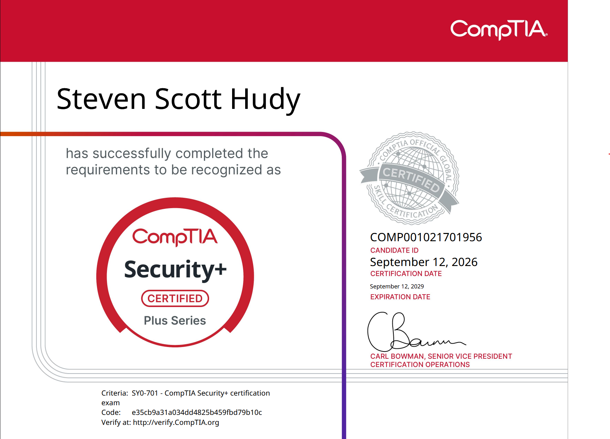
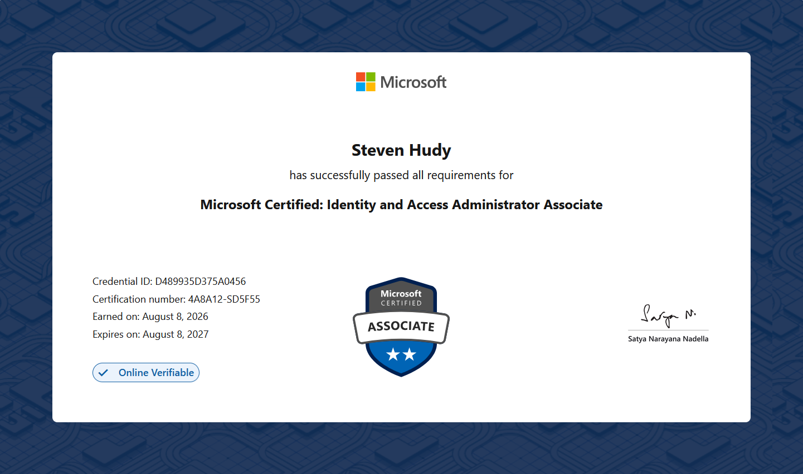
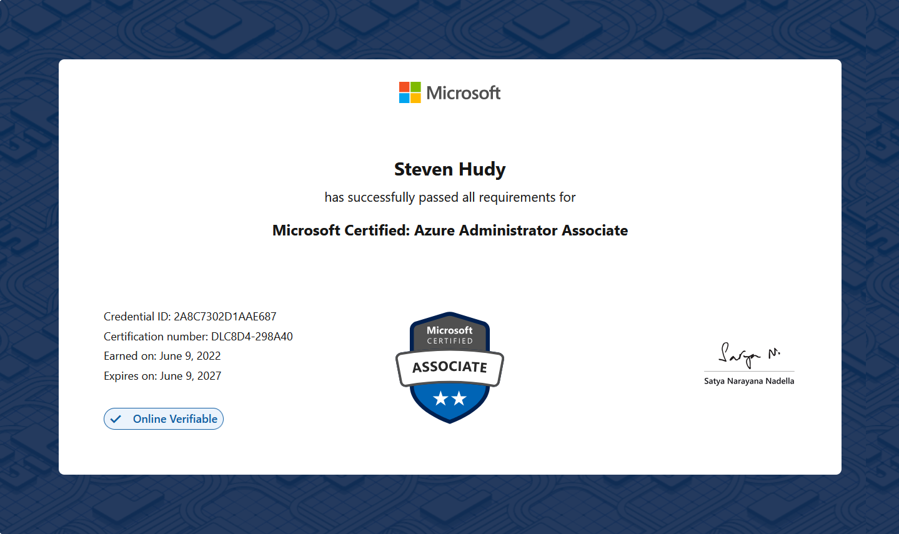
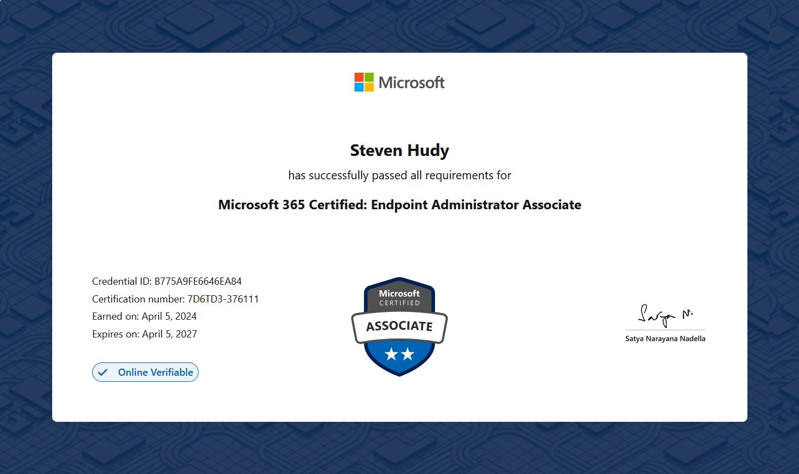

# Certifications & Education

Here is a summary of my professional certifications and academic background in information technology, systems administration, and identity security.

## Professional Certifications

* **CompTIA Security+**
  * **Issuer:** CompTIA
  * **Focus:** Baseline cybersecurity skills, including network security, threat management, identity and access management, cryptography, and operational security.
  * **[Credential Verification](https://cp.certmetrics.com/comptia/en/public/verify/credential/e35cb9a31a034dd4825b459fbd79b10c)**

  

* **Microsoft Identity and Access Management Associate (SC-300)**
  * **Issuer:** Microsoft
  * **Focus:** Designing, implementing, and operating identity and access management systems using Entra ID, governance, privileged identity management (PIM), and identity protection.
  * **[Credential Verification](https://learn.microsoft.com/en-us/users/stevehud-2504/credentials/d489935d375a0456?ref=https%3A%2F%2F)**

  

* **Microsoft Azure Administrator Associate (AZ-104)**
  * **Issuer:** Microsoft
  * **Focus:** Managing Azure subscriptions and resources, securing identities, administering storage, configuring and managing virtual networks, and monitoring Azure resources.
  * **[Credential Verification](https://learn.microsoft.com/en-us/users/stevehud-2504/credentials/2a8c7302d1aae687?ref=https%3A%2F%2F)**

  

  * **Microsoft Endpoint Administrator Associate (MD-102)**
    * **Issuer:** Microsoft
    * **Focus:** Validates expertise in deploying, configuring, hardening, and managing endpoints and mobile devices across enterprise environments using Microsoft Intune, Autopilot, and Entra ID.
   * **[Credential Verification](https://learn.microsoft.com/en-us/users/stevehud-2504/credentials/b775a9fe6646ea84?ref=https%253A%252F%252F)**

  

## Education

* **Associate Degree in Computer Network Administration and Security Technology**
  * **Institution:** Stark State College
  * **Focus:** Comprehensive and hands-on education covering cybersecurity fundamentals, networking fundamentals, Windows Server administration, Linux administration, operating system security.

---
[← Back to Home](index.md)